# 🚗 ระบบขออนุญาตใช้รถ — วิทยาลัยเทคนิคบุรีรัมย์

ระบบขออนุญาตใช้รถยนต์ของทางราชการแบบออนไลน์ — ผู้ขอยืมกรอกแบบฟอร์มและเซ็นชื่อผ่านหน้าเว็บได้โดยไม่ต้องมีบัญชี
จากนั้นเอกสารจะถูกส่งต่อให้เจ้าหน้าที่แต่ละขั้นเซ็นอนุมัติในระบบ และออกเป็น **แบบขออนุญาตใช้รถ (PDF)** ที่หน้าตาเหมือนแบบฟอร์มกระดาษ พร้อมลายเซ็นของทุกขั้น

> สร้างด้วย **React + Vite + Tailwind CSS** (Frontend) และ **Express + MongoDB** (Backend) — ภาษาไทยทั้งระบบ 🇹🇭 รองรับ Dark mode และมือถือ

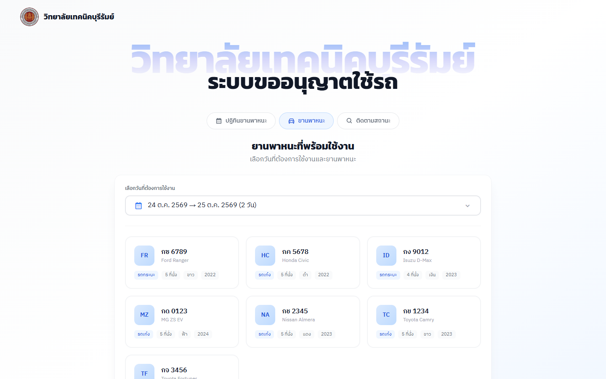

---

## 📑 สารบัญ

- [ภาพตัวอย่างการใช้งาน](#-ภาพตัวอย่างการใช้งาน)
- [ฟีเจอร์](#-ฟีเจอร์)
- [ขั้นตอนการเซ็นเอกสาร](#️-ขั้นตอนการเซ็นเอกสาร)
- [บทบาทผู้ใช้](#-บทบาทผู้ใช้)
- [การติดตั้งและรัน](#-การติดตั้งและรัน)
- [โครงสร้างโปรเจค](#️-โครงสร้างโปรเจค)
- [Environment Variables](#-environment-variables)
- [ฐานข้อมูลและการทดสอบ](#️-ฐานข้อมูลและการทดสอบ)

---

## 📸 ภาพตัวอย่างการใช้งาน

### หน้าสาธารณะ (ผู้ขอยืม — ไม่ต้องเข้าสู่ระบบ)

| ส่งคำขอยืม | ติดตามสถานะด้วยชื่อหรือเบอร์โทร |
|---|---|
| 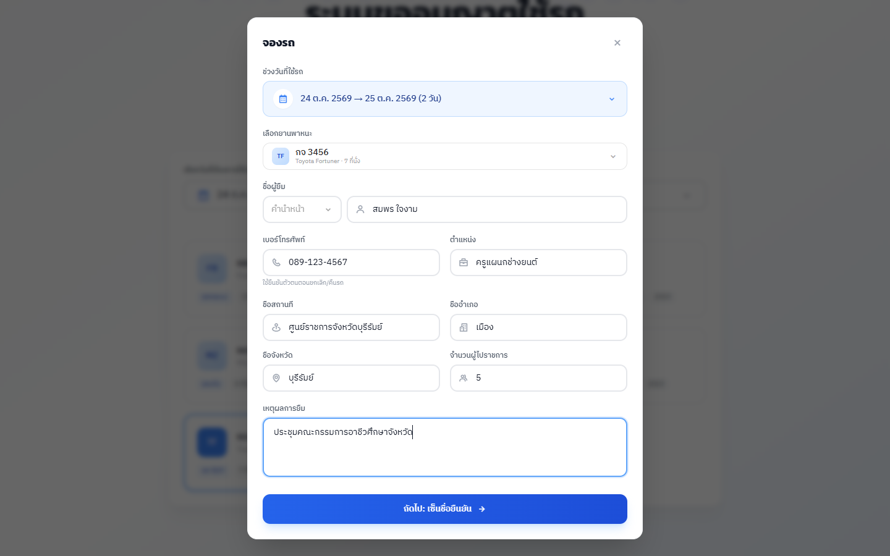 | 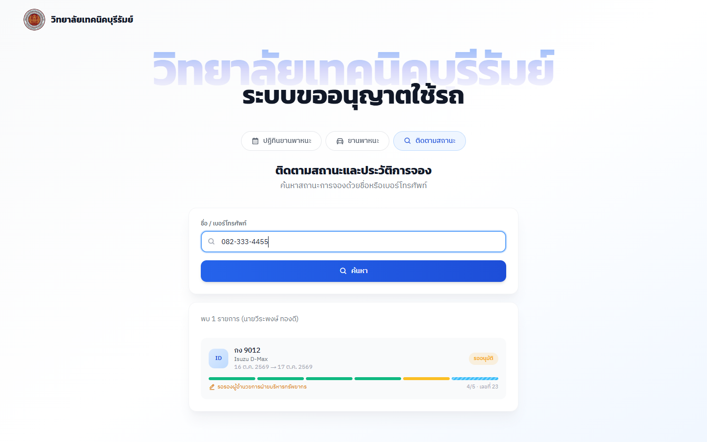 |

| ปฏิทินยานพาหนะ | มือถือ |
|---|---|
| 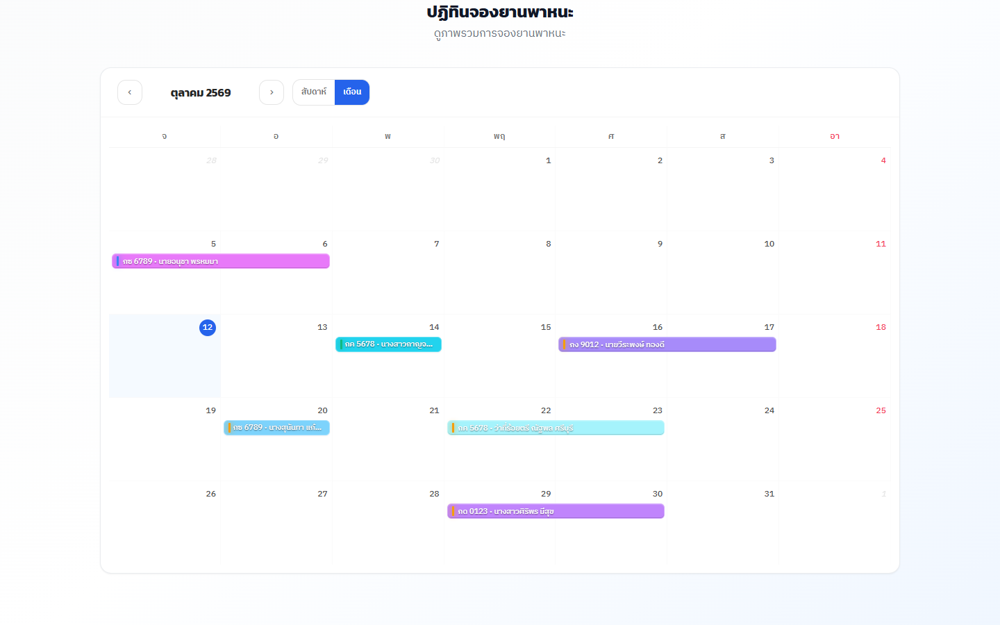 | 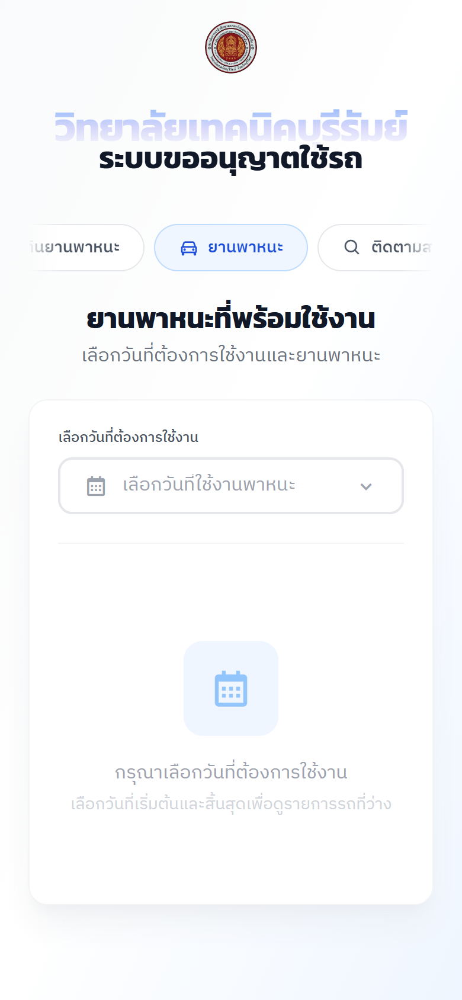 |

### หลังบ้าน (เจ้าหน้าที่ / ผู้ดูแลระบบ)

**แดชบอร์ด** — สรุปรถว่าง คำขอที่รอดำเนินการ กำหนดการ 7 วัน และแนวโน้ม 6 เดือน

| Light mode | Dark mode |
|---|---|
| 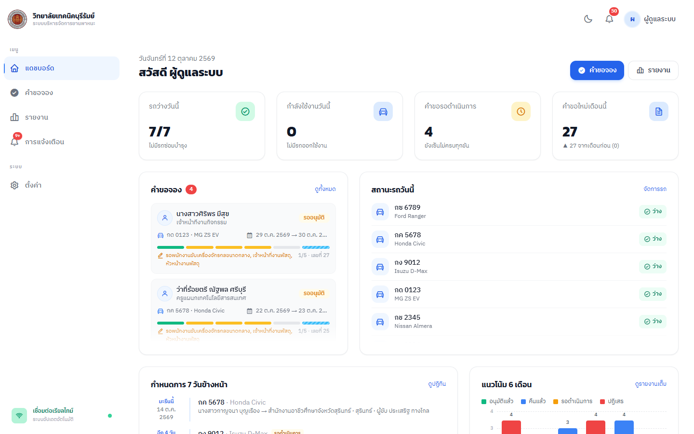 | 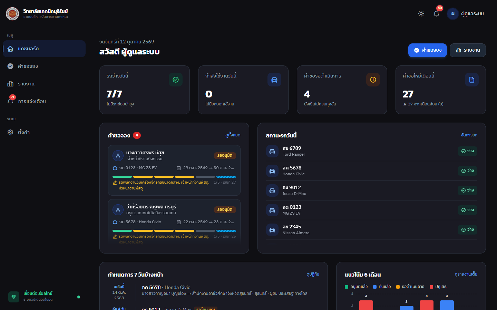 |

**รายละเอียดคำขอ + เอกสาร PDF** — กดที่การ์ดหรือแถวคำขอเพื่อดูเอกสารจริงและลำดับการเซ็นทุกขั้น
(ขั้นที่ตั้งเป็น "เซ็นบนกระดาษ" จะแสดงเป็นสีฟ้าและมีชื่อพิมพ์รอไว้ใน PDF)

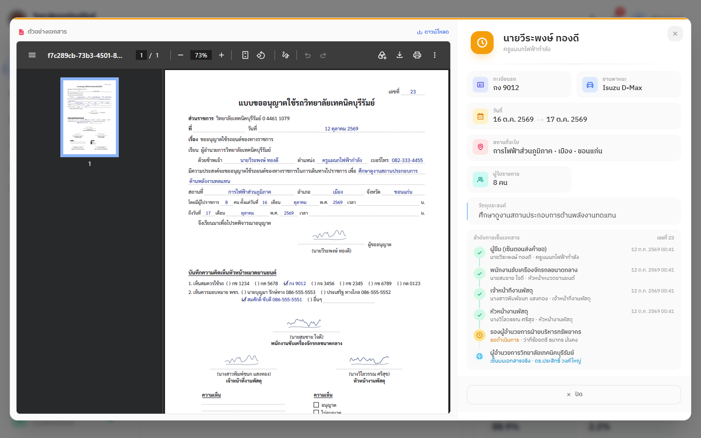

**เซ็นเอกสาร** — เลือกพนักงานขับรถ แล้วเซ็นด้วยนิ้ว/เมาส์ อัปโหลดรูป หรือแตะ "ใช้ลายเซ็นที่บันทึกไว้" ได้ในครั้งเดียว

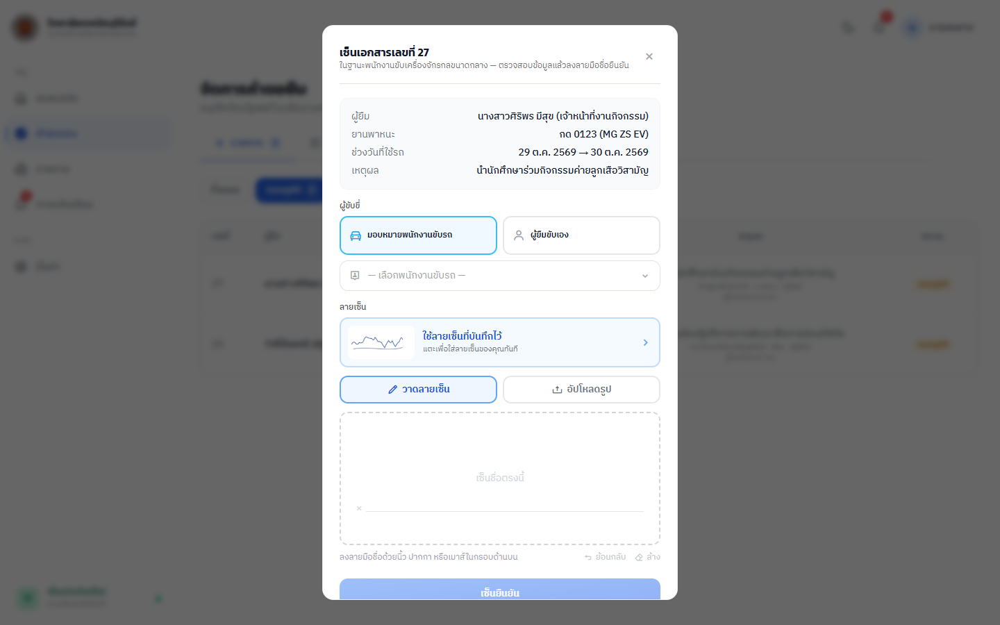

| รายการคำขอ | ปฏิทินการจอง |
|---|---|
| 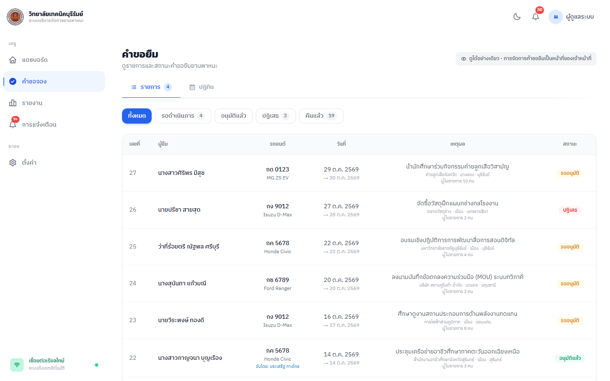 | 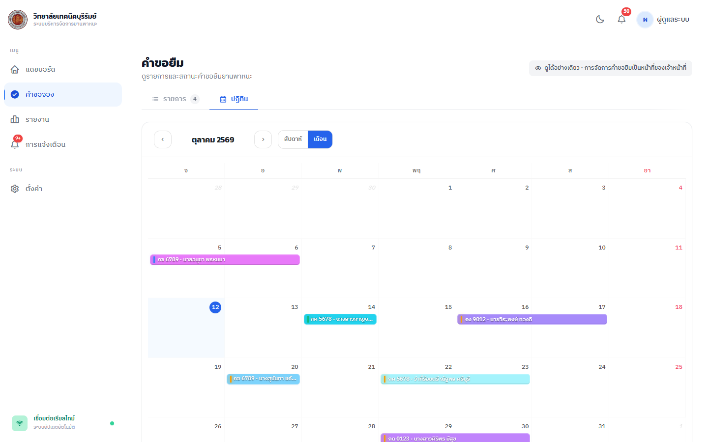 |

| รายงานสถิติ (ส่งออก CSV ได้) | โปรไฟล์ + ลายเซ็นที่บันทึกไว้ |
|---|---|
| 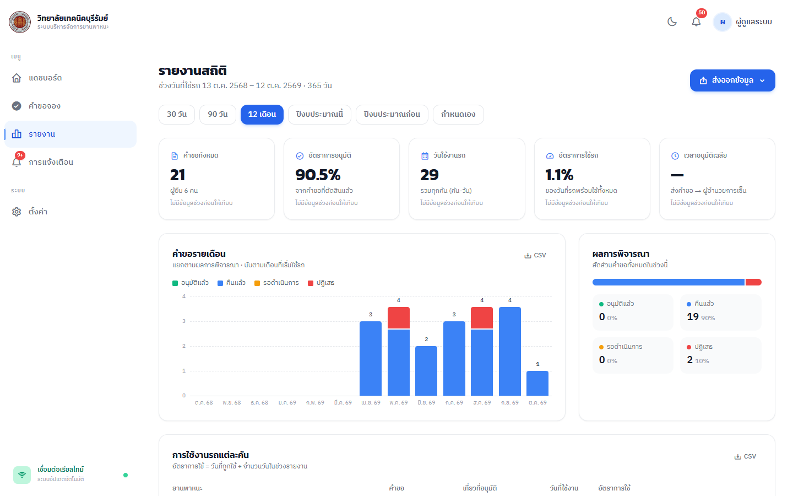 | 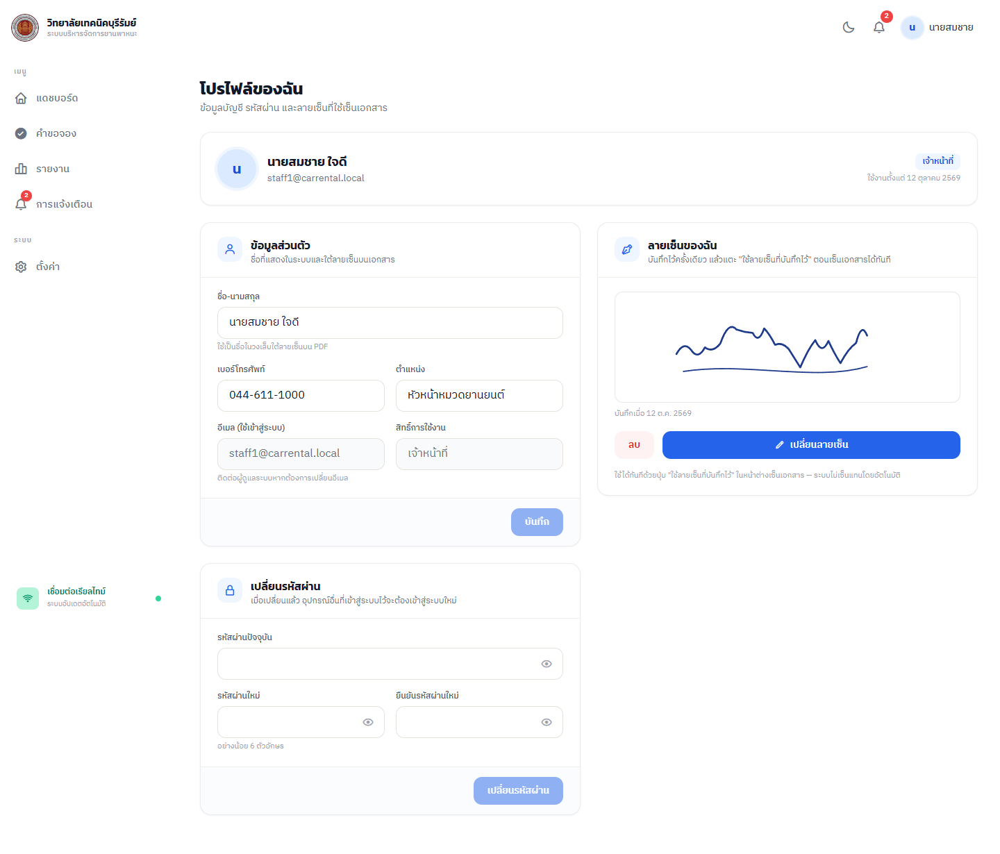 |

| ตั้งค่าผู้เซ็นเอกสาร (เซ็นในระบบ / เซ็นบนกระดาษ) | จัดการผู้ใช้ |
|---|---|
| 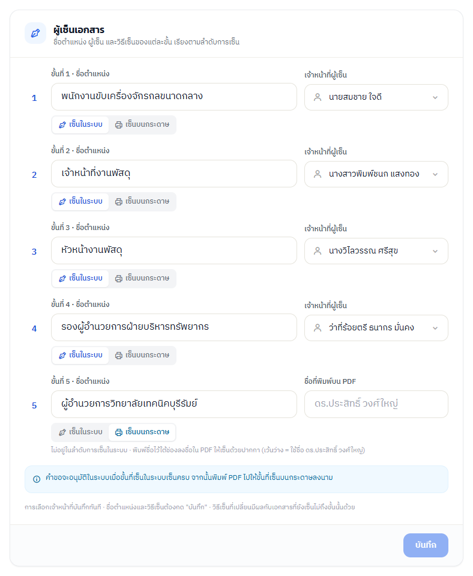 | 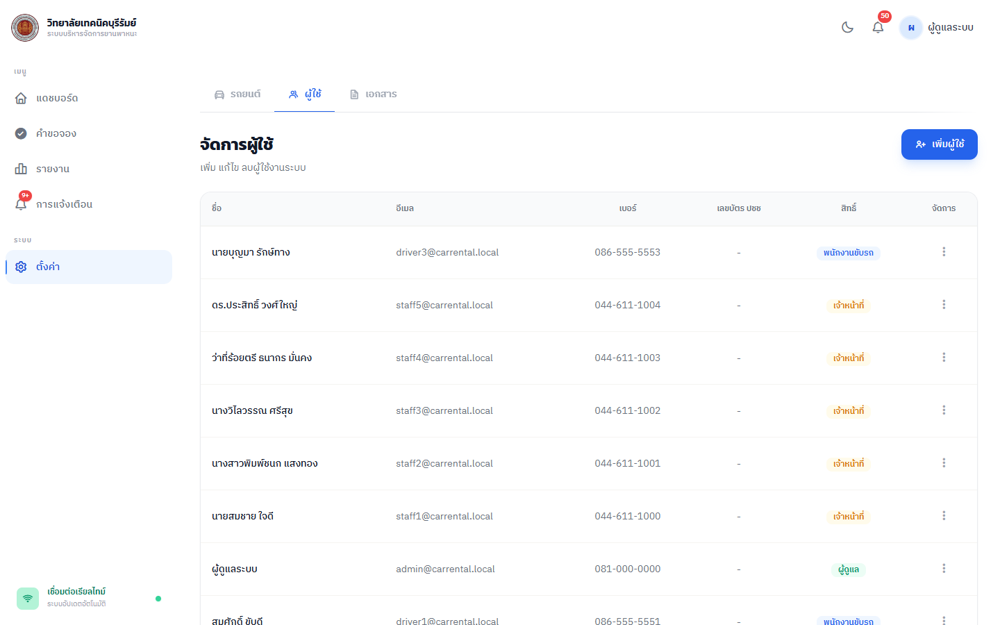 |

📄 ตัวอย่างเอกสารที่ระบบสร้าง: [docs/sample-request.pdf](docs/sample-request.pdf)

---

## ✨ ฟีเจอร์

### 👤 หน้าสาธารณะ (ผู้ขอยืม)
- 🚙 **เลือกช่วงวันแล้วเห็นเฉพาะรถที่ว่าง** — กรอกแบบฟอร์ม (คำนำหน้า ชื่อ ตำแหน่ง สถานที่ อำเภอ จังหวัด จำนวนผู้ไปราชการ วัตถุประสงค์) แล้วเซ็นชื่อยืนยัน
- 📅 **ปฏิทินยานพาหนะ** — มุมมองรายสัปดาห์ (แยกแถวตามทะเบียนรถ) และรายเดือน
- 🔍 **ติดตามสถานะ** ด้วยชื่อหรือเบอร์โทร — เห็นแถบความคืบหน้าการเซ็นทุกขั้น ดาวน์โหลด PDF ยกเลิกคำขอ หรือแจ้งคืนรถได้เอง (ยืนยันตัวตนด้วยเบอร์โทร)
- ผู้ขอยืม **ไม่ต้องมีบัญชี** — ชื่อ/เบอร์โทรถูกบันทึกไว้ที่คำขอโดยตรง

### ✍️ เอกสารและการเซ็น
- 📄 **สร้าง PDF แบบขออนุญาตใช้รถ** ด้วยฟอนต์ Sarabun — มีรายการทะเบียนรถและพนักงานขับรถทั้งหมดพร้อมช่อง ( ) ติ๊กเลือก เหมือนแบบฟอร์มกระดาษ
- 🖊️ **ลายเซ็นลื่นเหมือนปากกา** — เส้นนุ่มตามความเร็ว ย้อนกลับได้ ครอปขอบว่างให้อัตโนมัติก่อนบันทึก
- 💾 **บันทึกลายเซ็นไว้ใช้ซ้ำ** — เจ้าหน้าที่บันทึกครั้งเดียวในหน้าโปรไฟล์ แล้วแตะครั้งเดียวตอนเซ็น
- 🖨️ **ขั้นที่เซ็นบนกระดาษ** — ตั้งได้รายขั้น ขั้นนั้นจะถูกข้ามในระบบ แต่ชื่อผู้เซ็นยังพิมพ์ไว้ใน PDF ให้ลงนามด้วยปากกา
- 🔢 **เลขที่เอกสาร** รันอัตโนมัติ ตั้งคำนำหน้า/ต่อท้ายเลขได้

### 🛠️ หลังบ้าน
- 📊 **แดชบอร์ด** — รถว่างวันนี้ รถที่กำลังใช้งาน คำขอรอดำเนินการ กำหนดการ 7 วันข้างหน้า แนวโน้ม 6 เดือน
- 📋 **คำขอยืม** — แยกแท็บตามสถานะ (เจ้าหน้าที่เห็น "รอฉันเซ็น" ของตัวเอง) สลับมุมมองรายการ/ปฏิทินได้
- 📈 **รายงาน** — ช่วง 30/90 วัน 12 เดือน ปีงบประมาณ หรือกำหนดเอง, สถิติรายเดือน ผลการพิจารณา อัตราการใช้รถแต่ละคัน, ส่งออก CSV
- 🔔 **แจ้งเตือนแบบเรียลไทม์** (Server-Sent Events) — เจ้าหน้าที่ได้รับแจ้งเมื่อเอกสารมาถึงขั้นของตน ผู้ดูแลได้รับแจ้งเมื่ออนุมัติครบ/ไม่อนุญาต
- ⚙️ **ตั้งค่า**
  - **รถยนต์** — เพิ่ม/แก้ไข/เปลี่ยนสถานะ (พร้อมใช้ ซ่อมบำรุง ปลดระวาง)
  - **ผู้ใช้** — เพิ่ม/แก้ไขเจ้าหน้าที่ ผู้ดูแล และพนักงานขับรถ พร้อม dropdown คำนำหน้า
  - **เอกสาร** — ข้อมูลหน่วยงานบนหัวกระดาษ, รูปแบบเลขที่, ผู้เซ็นแต่ละขั้น (ชื่อตำแหน่ง ผู้รับผิดชอบ เซ็นในระบบ/บนกระดาษ), เงื่อนไขการยืม (ล่วงหน้าขั้นต่ำ/สูงสุด จำนวนวันสูงสุด), รายการคำนำหน้าชื่อ (เพิ่ม/ลบ/เรียงลำดับได้ เช่น ดร., ว่าที่ร้อยตรี)
- 👤 **โปรไฟล์** — แก้ไขข้อมูลส่วนตัว เปลี่ยนรหัสผ่าน และจัดการลายเซ็นที่บันทึกไว้

---

## ✍️ ขั้นตอนการเซ็นเอกสาร

```
ผู้ขอยืม (เซ็นตอนส่งคำขอ)
   │
   ├─▶ 1. พนักงานขับเครื่องจักรกลขนาดกลาง (หัวหน้าหมวดยานยนต์) ─┐  เซ็นพร้อมกันได้
   ├─▶ 2. เจ้าหน้าที่งานพัสดุ                                   ├─ (ขั้นแรกที่เซ็นเป็นผู้เลือก
   └─▶ 3. หัวหน้างานพัสดุ                                      ─┘   พนักงานขับรถ)
                 │
                 ▼
       4. รองผู้อำนวยการฝ่ายบริหารทรัพยากร   (อนุญาต / ไม่อนุญาต)
                 │
                 ▼
       5. ผู้อำนวยการวิทยาลัยเทคนิคบุรีรัมย์   (อนุญาต / ไม่อนุญาต)
                 │
                 ▼
            ✅ อนุมัติแล้ว → คืนรถ
```

- ชื่อตำแหน่งและผู้เซ็นของแต่ละขั้นปรับได้ที่ **ตั้งค่า → เอกสาร → ผู้เซ็นเอกสาร** — ชื่อผู้เซ็นที่กำหนดไว้จะพิมพ์รอไว้ใน PDF ทันที
- เฉพาะขั้นที่ 4 และ 5 ที่ "ไม่อนุญาต" ได้ — คำขอจะถูกปิดเป็น **ปฏิเสธ**
- ขั้นที่ตั้งเป็น **เซ็นบนกระดาษ** จะถูกข้ามในระบบ — คำขออนุมัติเมื่อขั้นที่เซ็นในระบบเซ็นครบ แล้วพิมพ์ PDF ไปให้ลงนามจริง
  การตั้งค่านี้ถูก "แช่แข็ง" ไว้กับคำขอแต่ละใบตั้งแต่ตอนส่ง การเปลี่ยนภายหลังไม่กระทบเอกสารที่เซ็นไปแล้ว (ต้องมีอย่างน้อย 1 ขั้นที่เซ็นในระบบ)

---

## 👥 บทบาทผู้ใช้

| บทบาท | เข้าสู่ระบบ | ทำอะไรได้ |
|---|---|---|
| **ผู้ดูแลระบบ (admin)** | ✅ | ดูคำขอทั้งหมด (ดูอย่างเดียว) รายงาน และตั้งค่าทั้งหมด |
| **เจ้าหน้าที่ (staff)** | ✅ | เซ็นเอกสารในขั้นที่ได้รับมอบหมาย จัดการคำขอ (บันทึกคืนรถ) บันทึกลายเซ็น ดูรายงาน |
| **พนักงานขับรถ (driver)** | ❌ | เป็นรายชื่อสำหรับมอบหมายให้ขับรถเท่านั้น |
| ผู้ขอยืม | ❌ (ไม่ใช่บัญชี) | ส่งคำขอ ติดตามสถานะ ยกเลิก/คืนรถผ่านหน้าสาธารณะ |

### 🔐 บัญชีทดสอบ

| บทบาท | อีเมล | รหัสผ่าน |
|---|---|---|
| ผู้ดูแลระบบ | admin@carrental.local | admin123 |

> บัญชีเจ้าหน้าที่ให้ผู้ดูแลสร้างที่ **ตั้งค่า → ผู้ใช้** แล้วกำหนดขั้นที่ต้องเซ็นที่ **ตั้งค่า → เอกสาร**

---

## 🚀 การติดตั้งและรัน

ต้องมี **Node.js 20+** และ MongoDB (ในเครื่องหรือ Atlas)

### 1. ติดตั้ง dependencies

```bash
npm install
cp .env.example .env   # แล้วแก้ค่าตามต้องการ
```

### 2. รัน development

```bash
npm run dev:all
```

คำสั่งเดียวรัน 3 อย่างพร้อมกัน:
- **db** — `mongod` ในเครื่อง เก็บข้อมูลที่ `.mongo-data/` (ข้ามไปเองถ้า `MONGODB_URI` ชี้ไปที่อื่น หรือมี MongoDB รันอยู่แล้ว)
- **api** — Express ที่ port 3000 (รีสตาร์ตอัตโนมัติเมื่อแก้ไฟล์ด้วย `node --watch`)
- **web** — Vite ที่ port 5173

> ฐานข้อมูลว่างจะถูก seed อัตโนมัติครั้งแรก (บัญชีผู้ดูแล + พนักงานขับรถ + รถตัวอย่าง) — `npm run seed` ใช้การันตีบัญชีทดสอบและรันซ้ำได้อย่างปลอดภัย

### 3. เปิดเบราว์เซอร์

- **หน้าสาธารณะ**: http://localhost:5173
- **เข้าสู่ระบบหลังบ้าน**: http://localhost:5173/login

### Production

```bash
npm run build                     # สร้าง dist/
NODE_ENV=production npm start     # Express เสิร์ฟทั้ง API และ dist/
```

หรือ deploy บน Vercel ได้โดยตรง (`api/index.js` + `vercel.json`)

### 📦 Scripts

| คำสั่ง | คำอธิบาย |
|---|---|
| `npm run dev:all` | รัน db + api + web พร้อมกัน |
| `npm run dev` | Vite dev server (frontend) |
| `npm run dev:server` | Express API แบบ watch mode |
| `npm run dev:db` | mongod ในเครื่อง |
| `npm run build` | Build production |
| `npm start` | รัน server production |
| `npm run seed` | สร้างบัญชีทดสอบ (idempotent) |
| `npm test` | รันชุดเทสต์ทั้งหมด |
| `npm run lint` | ตรวจโค้ดด้วย ESLint |

---

## 🏗️ โครงสร้างโปรเจค

```
car-rental/
├── api/                          # Backend (Express 5)
│   ├── index.js                  # Serverless entry (Vercel)
│   ├── server.cjs                # Express app + production server
│   ├── db.cjs                    # MongoDB data layer (connect/CRUD/index/seed/lock)
│   ├── sse.cjs                   # Server-Sent Events (เรียลไทม์)
│   ├── seed.cjs                  # npm run seed
│   ├── assets/fonts/             # ฟอนต์ Sarabun สำหรับ PDF
│   ├── middleware/auth.cjs       # JWT + ตรวจสิทธิ์ตามบทบาท
│   ├── lib/
│   │   ├── signing.cjs           # ลำดับขั้นการเซ็น / ขั้นถัดไป / ขั้นกระดาษ
│   │   ├── paper-signers.cjs     # ชื่อผู้เซ็นบนกระดาษที่พิมพ์ใน PDF
│   │   ├── pdf.cjs               # สร้างแบบขออนุญาตใช้รถ (pdf-lib)
│   │   ├── doc-settings.cjs      # ตั้งค่าเอกสาร + เงื่อนไขการยืม
│   │   ├── doc-number.cjs        # เลขที่เอกสาร
│   │   ├── notify.cjs            # การแจ้งเตือนตามขั้นการเซ็น
│   │   ├── reports.cjs           # คำนวณรายงาน
│   │   ├── names.cjs             # รวมคำนำหน้ากับชื่อ
│   │   └── dates.cjs, pagination.cjs, http-error.cjs, load-env.cjs
│   ├── routes/
│   │   ├── public.cjs            # หน้าสาธารณะ: รถว่าง ปฏิทิน ส่งคำขอ ติดตาม ยกเลิก คืนรถ
│   │   ├── signing.cjs           # คิวเซ็น / ประวัติ / เซ็นเอกสาร
│   │   ├── bookings.cjs          # ปฏิทิน + PDF
│   │   ├── admin.cjs             # รถ ผู้ใช้ ผู้เซ็น ตั้งค่า แดชบอร์ด รายงาน
│   │   ├── auth.cjs              # Login / โปรไฟล์ / รหัสผ่าน / ลายเซ็นที่บันทึกไว้
│   │   ├── cars.cjs, notifications.cjs
│   └── __tests__/                # vitest + supertest
├── scripts/dev-db.cjs            # mongod ในเครื่องสำหรับ dev
├── src/                          # Frontend (React 18 + Vite)
│   ├── App.jsx                   # Router
│   ├── context/AppContext.jsx    # Auth, dark mode, SSE, แจ้งเตือน
│   ├── components/
│   │   ├── BookingDetailModal.jsx  # รายละเอียดคำขอ + PDF + ลำดับการเซ็น
│   │   ├── SignDocumentModal.jsx   # หน้าต่างเซ็นเอกสาร
│   │   ├── SignaturePad.jsx        # ช่องวาดลายเซ็น
│   │   ├── SavedSignatureManager.jsx
│   │   ├── SignProgress.jsx        # แถบความคืบหน้าการเซ็น
│   │   ├── CalendarMonthGrid.jsx, RangeDatePicker.jsx, ReportCharts.jsx
│   │   ├── PrefixSelect.jsx, Navbar.jsx, Sidebar.jsx, AppLayout.jsx ...
│   │   └── ui/                     # select, toast, pager, skeleton, spinner, empty-state
│   ├── pages/
│   │   ├── PublicBooking.jsx       # หน้าสาธารณะ
│   │   ├── Dashboard.jsx, CalendarPage.jsx, Notifications.jsx, Profile.jsx
│   │   ├── auth/Login.jsx
│   │   └── admin/                  # BookingsManage, Reports, Settings,
│   │                               # CarsManage, UsersManage, DocumentSettings
│   ├── lib/                        # constants, docSettings, savedSignature, csv, ...
│   └── styles/globals.css
├── docs/                         # ภาพตัวอย่างและตัวอย่าง PDF
├── public/                       # โลโก้ / favicon
└── tailwind.config.js, vite.config.ts, vitest.config.ts, eslint.config.mjs
```

---

## 🔑 Environment Variables

| Variable | จำเป็น | คำอธิบาย |
|---|---|---|
| `JWT_SECRET` | ✅ production | คีย์สำหรับเซ็น/ตรวจ JWT — ยาว ≥ 16 ตัวอักษร ถ้าไม่ตั้งบน production เซิร์ฟเวอร์จะไม่เริ่มทำงาน |
| `MONGODB_URI` | ✅ production | connection string ของ MongoDB (เช่น `mongodb+srv://…` จาก Atlas) |
| `MONGODB_DB` | ❌ (default `car-rental`) | ชื่อฐานข้อมูล |
| `PORT` | ❌ (default 3000) | พอร์ตของ backend |
| `SSE_REVALIDATE_MS` | ❌ (default 15000) | ทุกกี่ ms ที่ stream เรียลไทม์ตรวจ token กับฐานข้อมูลซ้ำ |
| `SSE_KEEPALIVE_MS` | ❌ (default 30000) | ทุกกี่ ms ที่ส่ง keep-alive บน stream |
| `MONGOD_PATH` | ❌ | path ของ `mongod` สำหรับ `npm run dev:db` |

ไฟล์ `.env` ถูกโหลดอัตโนมัติเมื่อรัน API และ `npm run seed` — **ตัวแปร environment จริงจะชนะค่าจากไฟล์เสมอ** (บน Vercel ตั้งที่ Project Settings → Environment Variables)

---

## 🛠️ Tech Stack

| Layer | Technology |
|---|---|
| Frontend | React 18, React Router 6, Tailwind CSS 3, Vite 6, Boxicons |
| Backend | Express 5, compression |
| Database | MongoDB (mongodb driver v6) |
| PDF | pdf-lib + @pdf-lib/fontkit (ฟอนต์ Sarabun) |
| Auth | JWT (jsonwebtoken) + bcryptjs |
| เรียลไทม์ | Server-Sent Events |
| Test / Lint | Vitest + Supertest, ESLint |

ปฏิทิน กราฟ ช่องวาดลายเซ็น และ dropdown เขียนเองทั้งหมด ไม่พึ่งไลบรารีภายนอก

---

## 🗄️ ฐานข้อมูลและการทดสอบ

คอลเลกชัน: `users`, `cars`, `bookings`, `notifications`, `settings`
(unique index ที่ `users.email` และ `cars.license_plate`)

สิ่งที่ระบบรับประกัน:

- **จองพร้อมกันไม่ได้รถคันเดียวกัน** — งานเขียนต่อรถคันเดียวกันถูกจัดคิว แล้วเช็กวันทับซ้อนก่อนบันทึก คำขอที่แพ้จะได้ `409`
- **เซ็น / อนุมัติ / คืนรถ เป็นการเปลี่ยนสถานะครั้งเดียว** — ถ้าเอกสารถูกแก้ไปก่อนแล้วจะได้ `409` แทนการเขียนทับ
- **เปลี่ยนรหัสผ่าน / เปลี่ยนบทบาท / ลบผู้ใช้ = token เดิมใช้ไม่ได้ทันที** (ผ่าน `token_version`)
- **stream เรียลไทม์ตรวจ token ซ้ำทุก 15 วินาที** — เซสชันที่ถูกยกเลิกจะถูกตัดและ logout อัตโนมัติ
- รายการคำขอไม่ส่งรูปลายเซ็นไปด้วย (ส่งเฉพาะตอนสร้าง PDF) เพื่อให้หน้ารายการโหลดเร็ว

### รันชุดเทสต์

```bash
npm test        # 114 เทสต์: auth, รถ, คำขอ, การเซ็นเอกสาร, หน้าสาธารณะ, concurrency, SSE, data layer
npm run lint
```

เทสต์ใช้ MongoDB จริง — ตั้ง `MONGODB_URI` (หรือ `TEST_MONGODB_URI`) ก่อนรัน
แต่ละไฟล์ใช้ฐานข้อมูลแยกของตัวเอง (`car-rental-test-*`) และลบทิ้งเมื่อรันเสร็จ จึงไม่แตะฐานข้อมูลจริง

### Pagination ของ API หลังบ้าน

`GET /api/admin/bookings` และ `GET /api/admin/users` คืนทุกรายการถ้าไม่ส่ง `page`/`limit`
เมื่อส่งมาจะได้ `{ …, total, page, limit, pages }` (สูงสุด 100 แถวต่อหน้า) และ `/api/admin/bookings` มี `counts` แยกตามสถานะติดมาด้วยเสมอ
